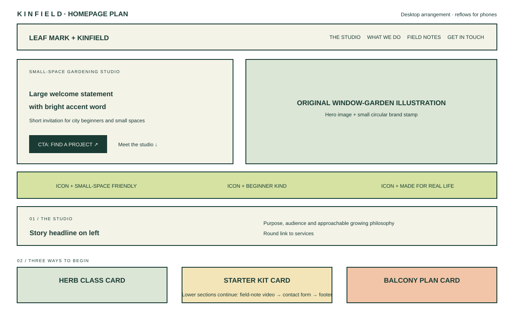

# Kinfield - small-space gardening studio

## Project and audience

Kinfield is a fictional small business concept: an urban gardening studio for people who want to grow herbs or leafy plants at home. The audience is city residents, especially beginners with a sunny window, shelf or compact balcony. The page introduces the studio, offers three ways to begin, shows a short flower video and provides a display-only contact form.

## Homepage structure

The page is one landing page with four internal destinations: Home, The studio, What we do, Field notes and Get in touch. The wide-screen layout uses a large split hero, a three-point approach strip, an editorial studio introduction, three service cards, a dark media panel and a contact section. On phones the navigation wraps, the hero and content stack, and service cards become compact image-and-copy rows.

## Colour palette

| Colour | Hex | Role |
| --- | --- | --- |
| Garden cream | `#F4F3E8` | Main page background |
| Deep forest | `#193B34` | Text, buttons, footer and media panel |
| New leaf | `#D5E2A2` | Values strip and small highlights |
| Persimmon | `#C55E3E` | Headline emphasis and links |
| Marigold | `#F2C65A` | Bright accents and one service card |
| Soft sage | `#DCE6D6` | Illustration and service card |
| Warm peach | `#F2C5A8` | Third service card |

The warm background and forest text establish a natural base. Persimmon and marigold provide sharper accents; sage, yellow and peach distinguish the three service cards while retaining a shared visual system.

## Typography

- **Headlines and card titles:** Trebuchet MS, then Arial and sans-serif fallbacks. The rounded, heavy letterforms give the studio a contemporary, approachable character.
- **Body and interface text:** Verdana, then Geneva and sans-serif fallbacks. The open shapes remain readable in small labels and on narrow screens.
- **Hierarchy:** oversized home statement, section headlines, medium service names and compact uppercase labels for navigation through the content.

## Content and multimedia

The three service illustrations and the brand mark are original SVG artwork stored in `assets/`. The flower video is an externally hosted MP4 sample from MDN, distributed under CC0; internet access is needed to play it. Source details are in `MEDIA_CREDITS.md`.

All business details and prices shown here are illustrative. The form uses native required and email validation, has no backend, and does not send or store its fields.

## Design principles

- **Contrast:** forest lettering on cream; a dark film section separates the media moment from the light editorial sections.
- **Repetition:** leaf motifs, framed artwork, numbered labels and the same accent colours connect page sections.
- **Alignment:** consistent page gutters, repeated section kickers, three aligned service cards and common card footers.
- **Proximity:** each service name, description and sample price stays together; each form label sits with its input.

## Student-authored text

The assignment brief asks for the student's own website text. The included English copy is an editable concept draft; rewrite it in your own words before submission.
